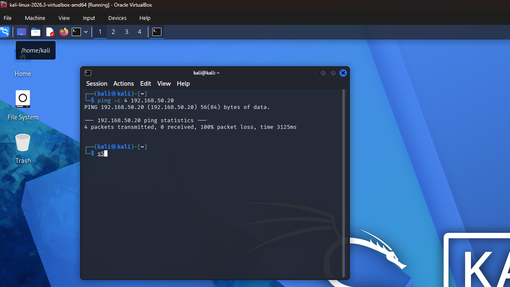
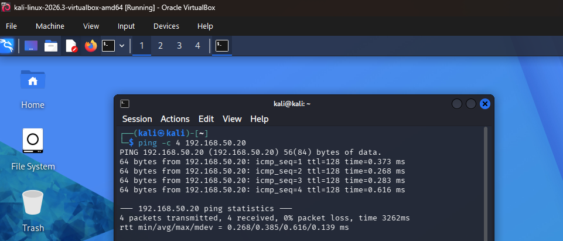
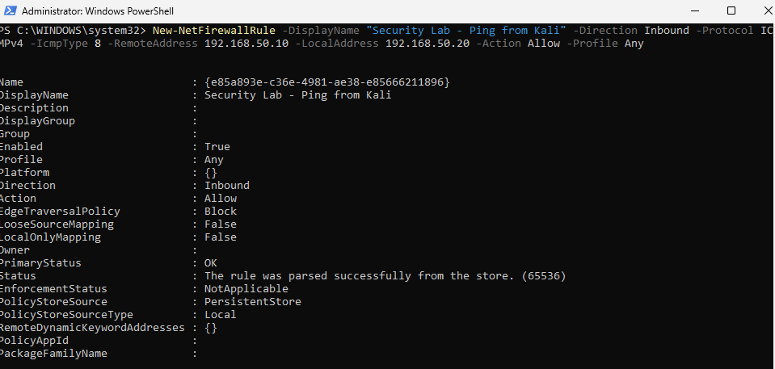

# Screenshot Evidence — Virtualized Cybersecurity Home Lab

The **13 original setup screenshots** were extracted from the Week 1 SOC Analyst and Ethical Hacking setup reports and published without the original report covers or student identifier.

Six additional screenshots document local Linux log practice on November 18, 2026 (19 images total). Only relevant VM images are included; report headers, student identifiers, and course-completion pages are excluded.

They support the technical claims in the [main README](../README.md), [network configuration](network-configuration.md), and [firewall troubleshooting case study](troubleshooting.md).

| Image | What it demonstrates |
| --- | --- |
| [Kali desktop](../screenshots/kali-desktop.png) | Kali Linux running inside VirtualBox |
| [Windows desktop](../screenshots/windows-desktop.png) | Windows 11 evaluation VM running |
| [Kali VirtualBox network](../screenshots/kali-virtualbox-network.png) | Internal Network selected for Kali |
| [Windows VirtualBox network](../screenshots/windows-virtualbox-network.png) | Matching internal network settings for Windows |
| [Kali static address](../screenshots/kali-static-address.png) | Kali `eth0` using 192.168.50.10/24 |
| [Windows IP configuration](../screenshots/windows-ipconfig.png) | Windows using 192.168.50.20/24 |
| [Initial failed Kali ping](../screenshots/kali-ping-failed.png) | Four transmitted pings with 100% loss |
| [Initial PowerShell access denied](../screenshots/powershell-access-denied.png) | Firewall change blocked by lack of elevation |
| [Successful firewall rule](../screenshots/powershell-firewall-rule.png) | Targeted inbound ICMPv4 rule created in elevated PowerShell |
| [Windows → Kali ping](../screenshots/windows-to-kali-success.png) | Four responses; 0% loss |
| [Kali → Windows ping](../screenshots/kali-to-windows-success.png) | Four responses; 0% loss after firewall adjustment |
| [Kali dual interfaces](../screenshots/kali-dual-interfaces.png) | `eth0` for internal network and `eth1` for NAT |
| [Kali package index update](../screenshots/kali-package-index.png) | Repository connectivity through the NAT interface |

## Evidence highlights

**Firewall troubleshooting — initially blocked inbound ICMP:**

**Successful verification — Kali can reach Windows after creating the rule:**

**PowerShell — new firewall rule created with administrator privileges:**

## Notes

- Screenshots are from an **isolated educational lab**, not a production environment.
- The Windows VM displayed an expired evaluation/activation warning; this remains a documented limitation.
- Private lab addresses (192.168.50.0/24) are included for reproducibility. No passwords, VM disks, or original internship report PDFs are published here.
- The screenshots demonstrate **networking, setup and troubleshooting**, not a completed SIEM deployment.

## Linux log inspection and monitoring — November 18, 2026

See the [full walkthrough](linux-log-analysis.md) for commands, observations, and interpretation limits.

| Image | What it demonstrates |
| --- | --- |
| [Available log sources](../screenshots/linux-logs/01-log-sources.png) | /var/log listing; auth.log and syslog are missing on this VM. |
| [Plain-text log tail](../screenshots/linux-logs/02-alternatives-log-tail.png) | Last ten lines of alternatives.log, including older terminal selection entries. |
| [Local sudo authentication failure](../screenshots/linux-logs/03-sudo-authentication-failure.png) | Current-boot journal search returning a local sudo authentication failure. |
| [Following a text log](../screenshots/linux-logs/04-follow-text-log.png) | tail -f waiting after existing alternatives.log entries; no new line demonstrated. |
| [Tagged test message](../screenshots/linux-logs/05-logger-test-message.png) | logger submits a benign message tagged Security-Lab. |
| [Live journal confirmation](../screenshots/linux-logs/06-live-journal-confirmation.png) | The same tagged message appears in the live journal. |

These images show local inspection and event verification, not remote collection, SIEM ingestion, or completed incident response.
