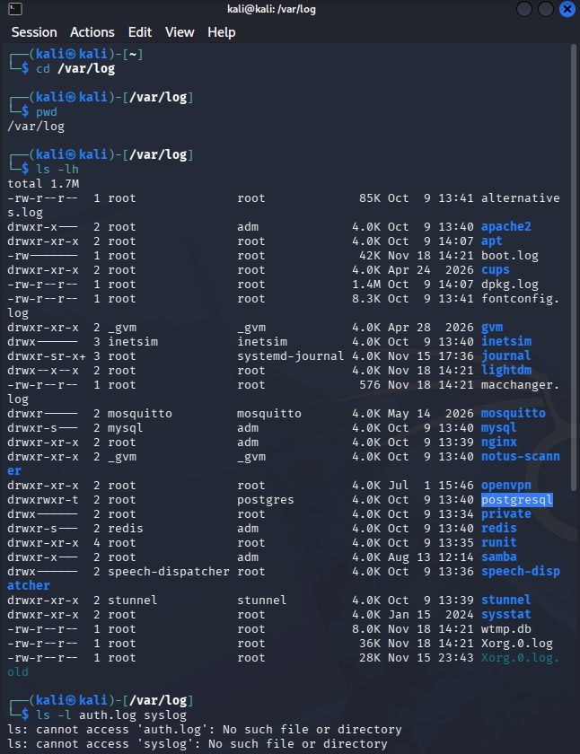
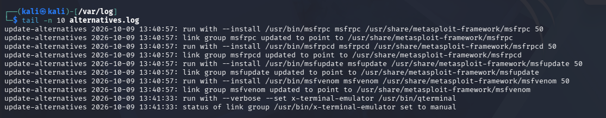
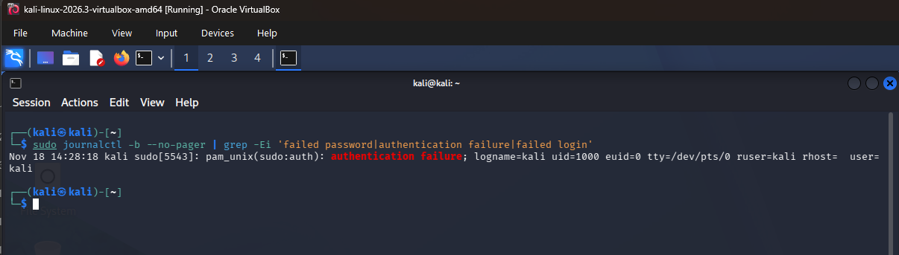
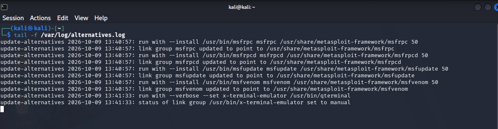
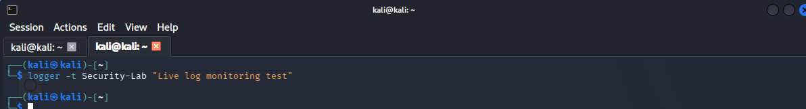
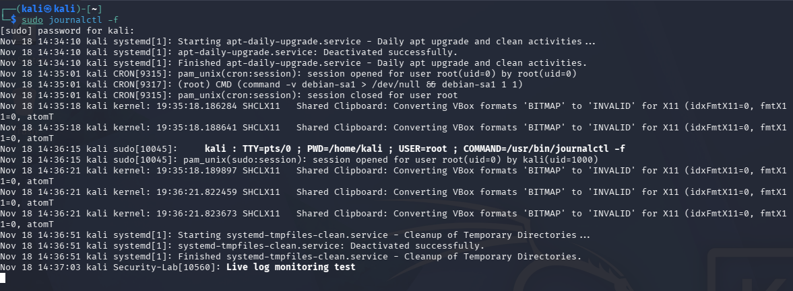

# Linux log inspection and live journal monitoring

**Kali Linux in VirtualBox · Local home lab · November 18, 2026**

## Objective and scope

Practice locating local Linux log sources, inspecting plain-text logs, searching authentication records, and verifying a new event in the system journal. This walkthrough documents the hands-on work performed on my own Kali VM during SOC Analyst internship training.

**Result:** I found an available journal when two expected log files were absent, identified a local sudo authentication failure, and confirmed that a tagged test message appeared while following the journal. This was introductory log practice, not a production investigation or completed SIEM deployment.

## 1. Locate the available logs

```bash
cd /var/log
pwd
ls -lh
ls -l auth.log syslog
```

Both `auth.log` and `syslog` returned **No such file or directory** on this VM. The directory listing included `/var/log/journal/` and `/var/log/alternatives.log`.



I used `journalctl` to inspect the system journal rather than assuming the missing files meant no logs were available:

```bash
sudo journalctl -b -n 30 --no-pager
```

- `-b`: restrict output to the current boot.
- `-n 30`: show the most recent 30 entries.
- `--no-pager`: print output directly.

**Learning point:** Check which log sources actually exist on the system. A missing traditional log file does not by itself establish that logging is broken. I did not investigate the full logging-service configuration in this exercise.

## 2. Read and search a plain-text log

```bash
cat /var/log/alternatives.log
less /var/log/alternatives.log
tail -n 10 /var/log/alternatives.log
grep -i 'update-alternatives' /var/log/alternatives.log
```

I practiced printing the file, scrolling through it, displaying its last ten lines, and finding case-insensitive matches. The displayed entries included a change to the default terminal emulator.



The alternatives log records changes to selected programs for common commands. It is not an authentication log. Its displayed entries predated this lab session, so they are not evidence of new activity on November 18.

## 3. Search the current boot for authentication failures

```bash
sudo journalctl -b --no-pager |
  grep -Ei 'failed password|authentication failure|failed login'
```

The pipe sends journal output to `grep`. The `-E` option allows the alternative patterns separated by `|`; `-i` ignores case.



At **14:28:18** in the VM's displayed log time, the search returned a `pam_unix(sudo:auth)` authentication failure associated with the local `kali` user and terminal `/dev/pts/0`. In this exercise, the event followed an incorrect sudo password entry.

**Interpretation:** This is evidence of a local sudo authentication failure. A single matching event does not establish an SSH attack, brute-force attempt, or compromise. The keyword search is a simple filter, not a comprehensive detection rule.

## 4. Follow a plain-text log

```bash
tail -f /var/log/alternatives.log
```



The screenshot shows existing entries followed by the command waiting. It demonstrates starting a file-following session; it does not show a new line arriving in this file.

## 5. Generate and observe a journal event

In one terminal, I followed the journal:

```bash
sudo journalctl -f
```

In another terminal, I submitted a benign test message:

```bash
logger -t Security-Lab "Live log monitoring test"
```



The live journal displayed the message at **14:37:03** in the VM's displayed log time:



**Verification:** The tag and message made the new entry identifiable among other system events. This confirmed local event arrival during the monitoring session. It did not test forwarding to another host, SIEM ingestion, alerting, or notifications.

## Skills practiced

| Skill | Concrete example |
| --- | --- |
| Linux navigation and log discovery | Checked `/var/log` and verified whether expected files existed. |
| Plain-text inspection | Used `cat`, `less`, `tail -n`, and `grep -i`. |
| Journal inspection | Used current-boot filtering and recent-entry output with `journalctl`. |
| Authentication-event interpretation | Read the service, user, terminal, and timestamp of a local sudo failure. |
| Live event verification | Followed the journal and located a message generated with `logger`. |
| Evidence-based documentation | Distinguished a waiting file-follow session from a confirmed new journal event. |

## Limitations and next steps

- Results apply to this Kali VM and the captured session; log paths and configurations may differ on other systems.
- Screenshots directly support the directory checks, tail output, authentication match, file-follow session, and logger test. Some additional commands above are documented in the source report without a separate screenshot for each.
- No Windows Event Viewer exercise, central logging, SIEM dashboard, alert, or incident-response workflow was completed as part of this milestone.
- Next steps: inspect Windows events, practice more focused journal searches, and later verify SIEM ingestion.

## Evidence handling

Only the six local VM screenshots relevant to this exercise are included. Report page headers, the student identifier, course-completion pages, and the original internship report PDF are not published. Screenshots contain the generic local lab username and system activity; no entered passwords or credentials were found in the selected images.

[Back to project overview](../README.md) · [Full evidence inventory](evidence.md) · [Project roadmap](../PROJECT_ROADMAP.md)
